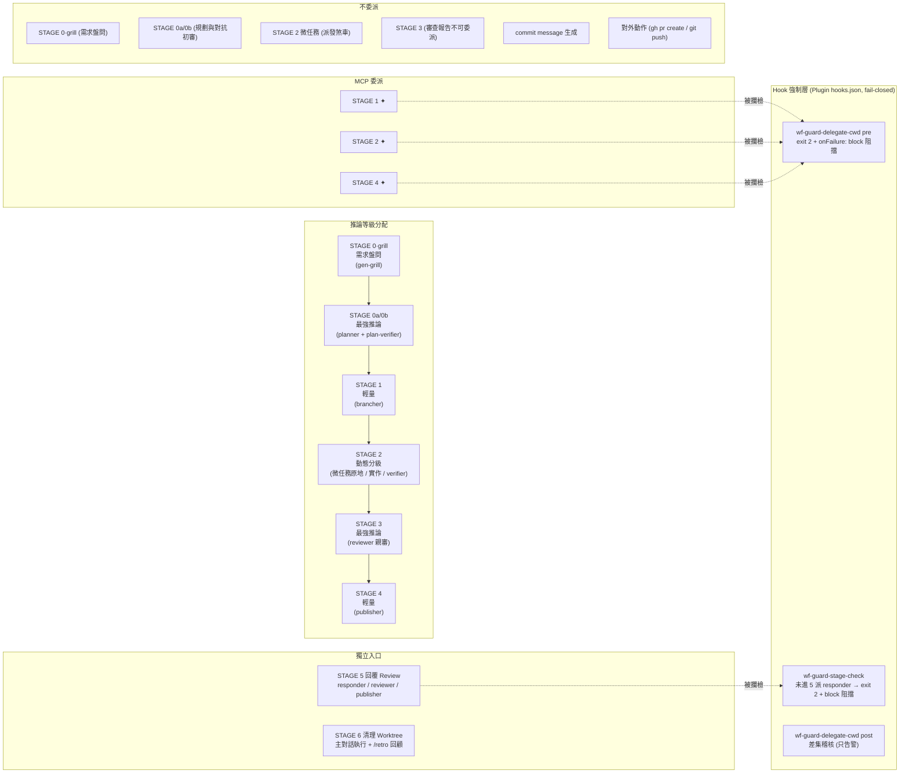

# gen-dev-workflow 全階段分析報告

> **📝 更新紀錄 (Changelog)**：
> * **2026-10-28**：全面同步專案實況至最新狀態（Issue #177–#222）。(1) **STAGE 0b 導入 `plan-verifier`**：獨立 Opus 對抗初審計畫，輸出二值契約 `READY` / `REVISE`（初審不計次，最多 2 次修訂，否則停下交由人類裁決）；(2) **STAGE 2 導入「派發煞車 (Dispatch Brake)」與 Verifier 階層式契約**：單檔 ≤ 20 行且無公共 API 變更之微任務強制原地修改不派發 subagent；Verifier 採 `PASS / FAIL: CODE / FAIL: INFRA` 三態契約，`FAIL: INFRA` 同 tier 自動重試 1 次，仍未定則暫停求助，且 verifier 唯讀不改碼；(3) **Model 與 Effort 宣告式契約綁定**：修正歷史誤診，確認 Claude Code 官方支援 agent frontmatter `effort:` 宣告並能覆蓋 session 預設，恢復所有 agent frontmatter 綁定；主流程啟動時自動寫入 `alwaysThinkingEnabled: true` 防護 400 錯誤並於結束時清理；(4) **STAGE 6 串接 `/retro` 環境回顧**：導入 Mechanical vs Judgement 二分法回顧建議；(5) **Hook 強制層全面 Plugin 化與 Fail-Closed 宣告**：守衛改由 Plugin 框架之 `hooks/hooks.json` 自動掛載（免手動設定 `settings.local.json`），且 PreToolUse 守衛宣告 `"onFailure": "block"` 杜絕崩潰穿透；(6) **修復 Bug 1.6**：`wf-state.sh promote` 自動推進 stage 至 1 並校驗來源狀態；(7) **視覺化總覽更新**：全面升級連結至 `docs/diagrams/2026-10-28` 系列架構與編排泳道圖。
> * **2026-09-19**：同步 PR #167（Issue #166）——新增 STAGE 0·grill 需求盤問關卡與 `gen-grill` skill。(1) 「各階段詳細分析」新增 STAGE 0·grill 一節；(2) 缺點表「錯誤傳播」列標註部分緩解；(3) 總覽的 stage 敘述補上本關卡。注意此關卡**不動狀態機、不是暫停點、不產生文件**，故 state machine 轉移表與 7 個暫停點的既有敘述維持不變。
> * **2026-09-04**：補上三處文件從未涵蓋的既有機制，並更新兩項因此失效的判斷。(1) 新增「Hook 強制層」章節——四個已註冊 hook（`wf-guard-stage-check`、`wf-guard-delegate-cwd` pre/post、`cbm-reindex-on-pr`）此前在本文件 0 次提及，其中兩個直接強制本 workflow 自身的規則；(2) 新增 batch 批次模式（此前僅 quick 模式有專節）；(3) 新增「Claude Workflow 編排」可選加速層。連帶修正：「委派後端依賴」缺點中「工作目錄靠 prompt 約束，屬文件層自律而非程式強制」一句已被 `wf-guard-delegate-cwd` 推翻，改為「pre 端已程式強制」；「最危險的假設」補上 hook 層作為第二道非自律防線。新增流程總覽圖連結。
> * **2026-08-12**：PR review 回應階段的一致性修正（PR #126）。四處敘述本身自相矛盾，非新增功能：(1) STAGE 2 驗收責任人在 `implementer.md`、SKILL.md、本文件三處定義不一，統一為「委派 verifier 做兩階段驗收、implementer 只複核」；(2) STAGE 6 清理執行模型在本文件表格、mermaid 圖 E6/F6、SKILL.md 摘要表之間矛盾，統一為「主對話執行、不委派」；(3) `publisher.md` 唯讀派發同時宣稱「不得跨出目錄」又說明會讀全域 CLAUDE.md，改為誠實描述限制；(4) `brancher.md` 重試對帳規則原寫「找到既有資源就復用」，與 `gen-dev-worktree`「已存在則停止回報」衝突，收緊為「僅復用能證明屬於本次嘗試的資源」。
> * **2026-08-10**：**委派後端由 `agy -p` headless 改為 `gemini-mcp-tool`（MCP）**。底層後端不變（仍是 antigravity-cli），換掉的是傳輸層——`agy -p` 不吃 stdin、權限卡死，委派實際一律落到 fallback；MCP 路徑實測可寫檔、可跑 shell、可 `git commit`。同步更新各 stage 委派欄、Model 策略、缺點表「agy 依賴」項，新增 MCP 路徑的三條委派紀律與已知限制。
> * **2026-08-06**：同步 SKILL.md 變更——STAGE 6 新增「文件同步」前置步驟（gen-sync-docs-by-branchs → gen-commit），確保 worktree 清理前 docs 已反映分支最終狀態。更新 STAGE 6 表格、委派規則、優缺點分析。
> * **2026-07-30**：同步審查 SKILL.md（含 `acf4f70` 新增的 STAGE 1 規劃文件搬移步驟）。STAGE 1 新增「帶入規劃文件」步驟、補記 Bug 1.6、更新總覽與優缺點分析。
> * **2026-07-21**：建立初版（從 `docs/features/` 移至 `docs/architecture/`）。

## 總覽

> 📊 **視覺化總覽**：[`docs/diagrams/2026-10-28-gen-dev-workflow-architecture.html`](../diagrams/2026-10-28-gen-dev-workflow-architecture.html) 與 [`docs/diagrams/2026-10-28-gen-dev-workflow-orchestration.html`](../diagrams/2026-10-28-gen-dev-workflow-orchestration.html)——分別涵蓋全域架構視角（含推論等級、委派邊界、三重視角切換）與泳道編排流程（主對話、Sub-agent、MCP 委派與 Hook 攔截層）。本文件是架構深度分析，圖表為視覺化指引，兩者互補。

`gen-dev-workflow` 是一個**全自動開發流程編排器**，從使用者說「幫我做 X 功能」到 PR 建立，共 6 個 stage（0a → 0b → 1 → 2 → 3 → 4，前方另有不進狀態機的 STAGE 0·grill 需求盤問關卡），外加兩個獨立入口的 STAGE 5（回覆 PR review）與 STAGE 6（PR 合併後清理 worktree），以及小修正用的 **quick 模式**（單暫停點快速通道，不建 worktree）。核心機制是 **Claude 做總指揮 + `gemini-mcp-tool`（MCP）做委派執行**。自 STAGE 1 起，整條流程搬進一個獨立 worktree 執行——worktree 才是真正的隔離邊界。

> **📌 委派後端的傳輸層變更（2026-08-10）**：後端一直是 antigravity-cli，但**傳輸層由 `agy -p` headless 改為 MCP 工具 `mcp__gemini-cli__ask-gemini`**。原因：`agy -p` 不吃 stdin、權限會卡死（見 [`brainstorm §2.3`](../brainstorm/2026-10-25-workflow-brainstorm.md)），委派實際一律落到 fallback，「委派」名存實亡。MCP 路徑經實測可寫檔、可改既有檔、可跑 shell 與 `git commit`，是同一後端唯一能真正委派的通道。
>
> **MCP 路徑的三條紀律**（因 MCP 無法指定 cwd 而必要）：
> 1. **工作目錄寫死在 prompt**——不寫絕對路徑，子進程可能在主 repo 而非 worktree 動手。
> 2. **跨出工作目錄先問**——派發 prompt 明令：需存取／修改該目錄外的檔案時停止回報，不自行動手。
> 3. **回報不等於事實**——子進程宣稱「已 commit」須由主對話親自 `git log` / `git status` 驗證。
>
> ⚠️ **已知限制**：MCP 呼叫無法帶 `--print-timeout`，長任務無逾時控制，需靠拆小任務規避。

Model 別名與 Effort 參數**綁在各 agent 檔 frontmatter**（`agents/*.md`，用 `opus`/`sonnet` 與 `xhigh`/`max`/`high`），可直接覆蓋主對話 session 當前的 effort。在主流程啟動前，編排器會自動透過 `.claude/settings.local.json` 寫入 `"alwaysThinkingEnabled": true`，徹底消除高 effort 搭配 thinking disabled 造成的 HTTP 400 組合約束風險；流程收尾時自動移除清理。SKILL.md 定義了**推論等級表**（對應的 model 與 effort 參數），以此維持不同 stage 之間的差異化配置。

---

## 各階段詳細分析

### STAGE 0·grill：需求盤問（planner 之前的必經步驟）

| 項目 | 內容 |
|------|------|
| **Agent** | 無（主對話呼叫 `gen-grill` skill，不派發 agent） |
| **Model** | 主對話自身 |
| **委派** | 無委派 |
| **並行** | 無 |
| **產出** | **不落檔**——唯一產出是印在對話裡的結構化 brief，交給 planner |
| **暫停點** | **不是暫停點**（盤問本身即對話往返，無 `stage-done` 棘輪） |

**收斂判準五項：** 問題定義／觸發場景／成功標準／範圍邊界／**既有覆蓋實查**。~~任一項缺 → 針對該項提問（一次一個，優先選擇題）→ 答完重新判定。~~ **2026-10-15 改版**：問法改對齊上游 `grilling`——五項改為決策樹的根節點，逐輪問完整個 frontier（每題附 ➡️ 推薦答案）、事實由 agent 自查不問使用者、frontier 清空後須使用者確認理解一致才交 brief。Q5 必跑、短路條件、quick 模式只跑 Q5 不變。

**短路條件**（已有文件背書／已 triage 的 issue／機械性改動／quick 模式）只跳過前四項，**既有覆蓋實查一律要跑**——本 repo 的 misalignment 主因是文件與實況漂移，而漂移恰好都發生在「看起來已有文件背書」的項目上。

**不動狀態機。** 此關卡發生在 `wf-state.sh init` 之後、planner 派發之前，轉移表維持 `0a→0b→1→2→3→4`，7 個暫停點不變。

> issue-id 路徑（跳過 STAGE 0a/0b）不經過本關卡，改在 STAGE 1 取得 issue 內容**之後**補跑既有覆蓋實查——該項判斷需要具體需求，只有 issue ID 無從判斷。

---

### STAGE 0a：功能規格（What & Why）

| 項目 | 內容 |
|------|------|
| **Agent** | planner |
| **Model** | 最強推論（planner frontmatter 宣告式綁定：`model: opus`、`effort: xhigh`；覆蓋 session 預設，派發時無需參數） |
| **委派** | 無委派，Claude 親自執行 |
| **並行** | 🟢 並行 2 條線：A. 專案 context 收集（讀檔 / git log）B. 相似功能代碼調查 |
| **產出** | `docs/features/YYYY-MM-DD-<feature>.md`（使用者故事、驗收條件、範圍邊界） |
| **暫停點** | ⏸ 展示規格 → 等使用者確認 |

**執行工作：**
1. 接收使用者需求描述
2. 並行啟動兩個研究任務（唯讀，不寫檔）
3. 收斂研究結果，撰寫功能規格文件
4. 暫停等待確認

---

### STAGE 0b：實作計畫（How）

| 項目 | 內容 |
|------|------|
| **Agent** | planner + plan-verifier |
| **Model** | 最強推論（planner 與 plan-verifier frontmatter：`model: opus`；`effort: xhigh`） |
| **委派** | 無委派 |
| **並行** | 無 |
| **產出** | `docs/plans/YYYY-MM-DD-<feature>.md`（資料結構、檔案異動、任務拆分 + 複雜度標註）+ plan-verifier 初審摘要 |
| **暫停點** | ⏸ 展示實作計畫與 plan-verifier 初審摘要 → 等使用者確認 |

**執行工作：**
1. 讀取 STAGE 0a 確認後的功能規格
2. 分析 codebase 結構
3. 拆分任務、標註複雜度等級（供 STAGE 2 model 選擇用；若為微任務則標記 `[原地修改]`）
4. 撰寫實作計畫文件
5. 呼叫 plan-verifier agent（獨立 Opus）執行對抗式初審：
   - 以全新上下文檢驗資料結構是否最小化、邊界情況是否消滅、任務拆分粒度與破壞性風險
   - 初審輸出二值契約：`READY`（放行）或 `REVISE`（打回重改）
   - 初審不計入修正次數；若 `REVISE`，退回 planner 修正計畫後再次複審（最多 2 次修訂；第 2 次修訂後複審仍為 `REVISE` 時停止自動推進，交由人類決策）
6. plan-verifier 判定 `READY` 後暫停等待使用者確認

---

### STAGE 1：建立 Issue + Worktree

| 項目 | 內容 |
|------|------|
| **Agent** | gen-gh-issue skill + brancher |
| **Model** | 輕量（brancher frontmatter：`model: sonnet`；`effort: high`）——純 IO，且建立前有暫停點人肉把關 |
| **委派** | ✦ MCP 執行 `gh issue create/view` + `git worktree add` + `flutter pub get`（`gh issue create` 須先過暫停點） |
| **並行** | 無 |
| **產出** | GitHub Issue + Git 分支 + **獨立 worktree** |
| **暫停點** | ⏸ 展示 Issue 標題/內容 + 分支/worktree 名稱 → 等使用者確認或修改 |

**執行工作：**
1. 取得 Issue 內容（正常路徑用 gen-gh-issue 產五區段 body；issue-id 路徑用 `gh issue view <id>` 解析既有 issue）
2. 依 `gen-dev-worktree` 規則決定 branch prefix + slug，草擬分支/worktree 名稱
3. 暫停讓使用者確認/修改
4. 確認後由 brancher 建立 **worktree + branch**（`git worktree add -b <branch> <worktree-path> origin/main`）
5. 執行 `wf-state.sh promote <pending-檔> --branch <branch> --dest <worktree>/.claude/workflow-state`：腳本自動校驗來源狀態、補上 `branch` 欄位並自動將 `stage` 推進為 `"1"`（徹底解決 Bug 1.6，無需任何 Workaround），刪除原 repo 的 pending 檔
6. 主對話 `cd` 進新 worktree 繼續後續所有 stage

**Worktree 命名與落地：** worktree 目錄為 `.claude/worktrees/<repo-name>-<ISSUE-ID>-<slug>`，建在當前 repo 內的 `.claude/worktrees/` 下，base 預設 `origin/main`。branch 名稱 `<prefix>/<ISSUE-ID>-<slug>`（prefix 含 `YYYYMM`）。若目標 branch 或 worktree 路徑已存在則停止回報，不默默重用或覆蓋。這個 worktree 是**整個 workflow 的長駐工作區**；主流程（STAGE 1–4）全程只用不刪，連 PR 合併都不會自動清除——要等使用者手動觸發 STAGE 6 才移除（刻意不自動清，避免 PR 合併後仍需修改時誤刪工作區）。

**🔴 帶入 STAGE 0a/0b 產出的規劃文件（正常路徑必做）：** 功能規格與實作計畫是在原 repo 目錄產出的未 commit 檔案，新 worktree 從 `origin/main` 拉出來時不會有它們。建好 worktree 後、`cd` 進去之前，用 `cp` 將 spec 與 plan 檔複製到新 worktree 的同名路徑，並驗證兩檔都存在。用複製不用 commit + cherry-pick（規劃文件由 STAGE 2 的 commit 一併帶進 branch）；原 repo 的那兩份留著不刪；issue-id 路徑略過本步驟。

**與 STAGE 2 臨時 worktree 的區別：** STAGE 1 的 worktree 是整個 workflow 的長駐工作區；STAGE 2 並行任務用的 `isolation: 'worktree'` 只是子 agent 層級的臨時隔離（跑完自動清除、不留存），僅避免並行任務互踩工作區，兩者不是同一回事。

---

### STAGE 2：實作（核心 Stage）

| 項目 | 內容 |
|------|------|
| **Agent** | implementer（微任務由主進程原地處理） |
| **Model** | 實作動態分級（見下表）｜驗收走 verifier agent（最強推論，階層式三態契約） |
| **委派** | ✦ MCP 負責一般任務代碼 + 測試 + commit（微任務命中派發煞車原地執行不委派）；驗收委派 verifier agent（frontmatter：`model: opus`；`effort: xhigh`，唯讀不改碼） |
| **並行** | 🟢 條件式並行（≥2 獨立非微任務且寫入路徑不重疊） |
| **產出** | 實作代碼 + 測試 + commits |
| **暫停點** | ⏸ 每個任務/每批並行完成後展示變更 + 測試結果 → 等確認 |

> **⚠️ implementer 只是協調者（Orchestrator Mode）：** `implementer` agent frontmatter 標題即為 `# Implementer (Orchestrator Mode)`，設計上是「工頭」角色——**本身不親自寫代碼**，而是把每個非微任務的「TDD 寫測試 → 實作 → 語意化 commit」透過 `mcp__gemini-cli__ask-gemini` 委派出去（Prompt 必附〈工作目錄與邊界〉+〈Ponytail 規則塊〉防範加料），自己只負責委派 verifier agent 做兩階段階層式驗收並複核其結論。因此上表「Model：實作動態分級」指的是**委派後端的 model**，不是 implementer 自己跑的推論等級；implementer 在 orchestrator 模式下幾乎不吃推論成本，Token 都花在委派側與 verifier 驗收。
>
> **唯一例外——MCP 不可用時的 Fallback：** implementer 退回 `subagent-driven-development` skill **親自逐任務實作**（仍守 TDD → 實作 → commit 順序）。此時它就不再只是協調者，而是實際執行者，實作推論成本改由 implementer 自身承擔。這條 Fallback 是 STAGE 2「協調者假設」失效的唯一情境，判讀成本/效能時需區分兩種模式。

**STAGE 2 任務分級與「派發煞車 (Dispatch Brake)」：**

| 任務複雜度信號 | 委派等級 | 範例 |
|---|---|---|
| **單檔 ≤ 20 行且無公共 API 變更（微任務）** | **🛑 原地修改（派發煞車，禁止派發 subagent）** | 改常數、修 typo、補單行防禦/assert、修文件註解 |
| 觸及 1–2 檔、規格完整、機械性 | 快/便宜（委派後端內部 fast model） | 新增 DTO 欄位、補 util function |
| 觸及多檔、需整合協調 | 標準 `sonnet` | 跨 service 串接、改既有流程 |
| 需設計判斷或廣泛 codebase 理解 | 最強推論 `opus` | 重構狀態機、新增跨層架構 |

> **驗收與實作分離**：驗收固定委派 verifier agent（frontmatter：`model: opus`；`effort: xhigh`），不隨實作任務浮動。刻意讓驗收等級 ≥ 實作等級，避免產代碼的便宜 model 自審。命中派發煞車之微任務，則由主進程在原地執行相關測試（如 `flutter test`），**不派發獨立 verifier subagent**，消除微小改動卻付出獨立 Opus 來回的延遲。

**階層式驗收契約 (PASS / FAIL: CODE / FAIL: INFRA)：**

Verifier 報告首行頂格輸出狀態前綴，主調度進程依前綴分流：
- **`PASS`**：規格逐項滿足、無多餘抽象/相依、測試與靜態分析全綠。記錄任務完成並推進。
- **`FAIL: CODE: <簡述>`**：規格偏離、過度工程、測試失敗或靜態分析新增警告。退回實作端修復後重驗。
- **`FAIL: INFRA: <簡述>`**：客觀環境異常、逾時、外部依賴未就緒等非程式代碼缺陷。**同 tier 自動重試 1 次**；若重試後依然為 `FAIL: INFRA`，**立即暫停向人類開發者求助**，嚴禁盲目升級 tier 或打回實作端改代碼。

**執行工作：**
1. 解析實作計畫任務總數 $N$，執行 `wf-state.sh set <檔> total_tasks=<N>` 啟動任務完整性檢驗閘門
2. 逐任務先過「派發煞車」門檻，微任務原地修改與跑測；非微任務判斷並行/序列模式並透過 MCP 分派
3. 委派 verifier agent 做兩階段驗收：spec compliance → code quality
4. 每個任務（或並行批次）完成後暫停展示結果
5. 失敗時進入 retry 迴圈（同 tier 最多 2 次 → 升一級 tier 試 1 次；基礎設施錯誤不計入失敗次數）

**並行契約（三規則）：**
1. 每個並行單元有明確寫入檔案清單
2. 共享資源（pubspec.yaml、DI 註冊等）只能有一個 owner
3. 結果聚合 + 失敗短路機制：全數 `PASS` 才計入完成；部分失敗即依賴鏈短路

---

### STAGE 3：審查

| 項目 | 內容 |
|------|------|
| **Agent** | reviewer |
| **Model** | 最強推論（reviewer frontmatter 宣告式綁定：`model: opus`、`effort: xhigh`；覆蓋 session 預設，派發時無需參數）——根因判斷 |
| **委派** | **不委派**（審查不可外包，主 reviewer 親審收斂） |
| **並行** | 無（未 opt-in）／可選 Workflow 多 angle 對抗式審查（已 opt-in） |
| **產出** | 審查報告（含 Guard Clause Record） |
| **暫停點** | ⏸ 展示報告 → 通過則進 STAGE 4，不通過則退回 STAGE 2 |

**執行工作：**
1. reviewer agent 親自審查所有變更（若已 opt-in 多 agent 編排，由 Workflow 平行派發 verifier 找 bug，reviewer 仍親自收斂判斷並產出報告）
2. **審查 Lens 雙層特徵裁決（A3 / PR #201）**：
   - **核心基線（必審）**：`correctness`（邏輯正確性）與 Ponytail `過度工程/可簡化` Lens（專門挑出計畫外加料抽象、可刪的 scaffolding；僅「plan 外加料」或「刪即更小 diff 且測試全過」兩情境阻擋退回，與 security 衝突時 security 勝出）。
   - **特徵驅動專門 Lens**：依改動特徵而非程式行數裁決——`security`（涉及網路、金鑰、敏感資料時）、`回歸風險`（涉及生命週期、核心緩衝區、公共 API 簽章時）、`測試覆蓋`（涉及新業務邏輯、演算法時）。
   - **免除判定紀錄（Guard Clause Record）**：若未派發某專門 Lens，主 Reviewer 必須在審查報告中簡要標註前置免除理由並親自覆核兜底，不得假裝該維度不存在。
3. 產出審查報告
4. 不通過 → 退回 STAGE 2 修正 → 再回 STAGE 3（迴圈）

**設計考量：** 審查用最強推論是為了避免「自己審自己」（實作走標準或更便宜等級，reviewer 刻意用不同源的最強推論交叉驗證）。以風險特徵驅動 Lens 派發取代行數一刀切，消滅同義反覆與 context 爆炸。

---

### STAGE 4：發布

| 項目 | 內容 |
|------|------|
| **Agent** | publisher |
| **Model** | 輕量（publisher frontmatter：`model: sonnet`；`effort: high`）——重活已委派，發布前有暫停點人肉把關 |
| **委派** | ✦ MCP 分析 Diff → 產 PR 草稿（唯讀）；Claude 校對；`gh pr create` 不委派 |
| **並行** | 無 |
| **產出** | GitHub PR |
| **暫停點** | ⏸ 展示 PR 草稿 → 等使用者確認發布 |

**執行工作：**
1. 委派分析 branch diff，依 gen-pr skill 格式生成 PR 描述草稿（Summary + 修正問題 / 修正方式）
2. Claude 校對草稿品質
3. 暫停讓使用者確認
4. 確認後由主進程發布 PR（不委派）
5. 🔴 環境清理：透過 Bash 與 `jq` 將 `.claude/settings.local.json` 中的 `"alwaysThinkingEnabled": true` 移除，避免殘留。worktree 與本地 branch 一律保留，不自動刪除

---

### STAGE 5：回覆 PR Review（獨立入口）

| 項目 | 內容 |
|------|------|
| **Agent** | responder → reviewer → publisher |
| **Model** | 輕量（responder：`sonnet` · `high`）→ 最強推論（reviewer：`opus` · `xhigh`）→ 輕量（publisher：`sonnet` · `high`） |
| **委派** | 無委派 |
| **並行** | 無 |
| **觸發** | 使用者說「PR #42 有新的 review 意見」 |

**執行工作：**
1. 🔴 第一步（不可跳過）：推進狀態至 STAGE 5
   - 既有工作區已存在 state 檔：`wf-state.sh advance <state_file> 5 --confirmed`
   - 新對話／獨立進入：`wf-state.sh init --mode jump --stage 5 --branch <branch> --set pr=<PR>`
   ↑ 未執行此步就派發 responder 屬流程違規，會被 `wf-guard-stage-check.sh` 攔截（`exit 2` + `onFailure: "block"`）
2. 啟動環境防護：確保 `.claude/settings.local.json` 包含 `"alwaysThinkingEnabled": true`
3. responder 逐條處理 PR review 意見
4. reviewer 重新審查修改（最強推論把關）
5. publisher 更新 PR 描述與留言
6. 🔴 環境清理：移除 `"alwaysThinkingEnabled": true`
7. 呼叫 `wf-state.sh stage-done <檔> 5` 結束 STAGE 5

---

### STAGE 6：清理 Worktree（獨立入口）

| 項目 | 內容 |
|------|------|
| **Agent** | gen-sync-docs-by-branchs → gen-commit → worktree-close-cleanup skill |
| **Model** | —（skill 於主對話執行，無獨立綁定） |
| **委派** | 不委派——主對話親自執行 `git worktree remove`，事後驗證 `git worktree list` / `git branch --list` |
| **並行** | 無 |
| **產出** | docs 同步更新 + commit → 移除 STAGE 1 建立的 worktree（**對應 branch 一律保留、不刪除**） |
| **觸發** | PR **實際合併後**，使用者說「PR #42 合併了，清理 worktree」 |

**執行工作：**
1. 🔴 第一步（不可跳過）：推進狀態至 STAGE 6
   - 既有工作區已存在 state 檔：`wf-state.sh advance <state_file> 6 --confirmed`
   - 新對話／獨立進入：`wf-state.sh init --mode jump --stage 6 --branch <branch>`
2. 呼叫 gen-sync-docs-by-branchs skill，以當前處理的分支為目標，將該分支的實際變更回寫到 docs 下的發想／結構說明文件（brainstorm、architecture 等）
3. 同步完成後呼叫 gen-commit skill 將文件變更 commit 進 git（避免同步結果在清理 worktree 時遺失）
4. 呼叫 worktree-close-cleanup skill 移除 STAGE 1 建立的 worktree
5. 只移除 worktree 本身，對應 branch 保留不刪除（沿用 worktree-close-cleanup 既有規則）
6. 🔴 環境清理：移除 `"alwaysThinkingEnabled": true`
7. 💡 **環境回顧建議（/retro）**：清理完成後，若本次開發過程有遇到摩擦、多次測試失敗或審查退回，建議輸入 `/retro` 進行環境回顧。遵循「Mechanical vs Judgement」嚴格二分法：機械性違規一律做成自動化檢查腳本（Hook / Linter / Bash 斷言），**嚴禁**寫入 prompt 或 rules；唯有真正的主觀權衡與架構邊界才提煉為指引修訂建議
8. 完成後流程結束

**設計考量：**
- **先 sync 再 commit 再清理**的順序是必要的——worktree 一旦 `remove`，裡面未 commit 的文件變更就永久遺失。gen-sync-docs-by-branchs 本身不 commit（見其鐵律），所以中間必須顯式呼叫 gen-commit 銜接。
- 不自動觸發——workflow 不偵測 PR 合併狀態並自動清理，需使用者明確告知已合併才執行，避免 PR 還可能需要修改時誤刪工作區。

---

### Quick 模式：小修正快速通道（獨立入口）

| 項目 | 內容 |
|------|------|
| **觸發** | `/gen-dev-workflow quick <描述或 #issue>`、「快速修正 <描述>」 |
| **適用** | 預期 diff 小（約 ≤3 檔）、無架構變動、無新依賴、不需規劃文件 |
| **流程** | 建 branch（不建 worktree）→ 主對話直接實作（不委派 implementer/MCP）→ reviewer 單 lens 快掃 → gen-pr 產草稿 → 發布 |
| **暫停點** | 只有一個：PR 草稿確認前 |
| **State** | 照寫 `<branch-slug>.json`（`mode: "quick"`），續接與 PR MERGED 自動刪檔複用既有機制 |

**設計考量：**
- 砍掉所有儀式（spec/plan 文件、issue 強制、worktree、逐任務暫停），唯一保留的品質閘門是 **reviewer 交叉審查**——「不讓同源 model 自審」是整條 workflow 不可砍的不變式。
- 不建 worktree ⇒ 同一 repo 同時只能跑一個 quick；需要多並行走完整流程。
- 中途發現超出小修正範圍（多檔設計判斷、新依賴、動架構）→ 停下告知並執行 `wf-state.sh upgrade` 轉入完整流程。**升級後必須立即建立對應的 git worktree，複製 Root 未 commit 變更並 promote 狀態 JSON，最後 cd 進入該工作區**，以防打破物理隔離的鐵律。

---

### Batch 模式：多需求依序執行（佇列，非 mode）

| 項目 | 內容 |
|------|------|
| **觸發** | `/gen-dev-workflow batch <項目1> <項目2> ...`、「依序做完這幾項」、「繼續批次」 |
| **本質** | **佇列類型，不是 mode**——批次的每一項各自跑完整的 `sequence` 流程（各自 worktree / branch / PR） |
| **狀態** | `.batch-<id>.json`（存原 repo 的 `.claude/workflow-state/`），與各項自己的 state 檔分離 |
| **指令** | `batch-init` → `batch-next` → `batch-done` / `batch-fail` → `batch-abort` |
| **關鍵限制** | **每項之間需使用者 `/clear` 換新 context**，再說「繼續批次」接下一項 |

**設計要點：**

- **`pause_level` 與批次佇列是正交的兩個控制粒度**——前者決定「每個 stage 跑完要不要問」，後者決定「有幾項要跑」。`batch-init` 可帶 `--pause-level balanced` 一次設定全批。
- **一項失敗不中止整個批次**：某項失敗（STAGE 3 連續退回、tier 升級後仍失敗）→ `batch-fail --note "<原因>"`，游標照常前進。各項獨立，沒有理由讓後面的陪葬；最終總結列出失敗項讓使用者決定要不要重跑。
- **`cd` 紀律**：每項跑完必須 `cd` 回原 repo 再收尾，否則下一項的 `batch-next` 會在錯誤的工作目錄找不到批次檔。這是批次模式特有的踩雷點。
- **中止**：`batch-abort` 只刪批次檔，**已建立的 branch / PR / worktree 一律保留**（沿用「branch 永不自動刪除」的既有紀律）。
- `batch-next` 回傳 `DONE` 後才刪批次檔，並輸出總結表（項目 / status / PR 連結 / 失敗原因）。

> **為何需要 `/clear`**：批次的價值在於「一次交代多個需求」，但每項跑完整流程都會累積大量 context。不 clear 就接著跑第二項，等於把 Token Budget Gate 的問題乘上項數。這是刻意的人工介入點，不是缺陷。

---

## Claude Workflow 編排（可選加速層）

流程中**特定的並行、唯讀或路徑不重疊、且該段落內部不需要問使用者**的環節，可改用 Claude `Workflow` 工具（JS 腳本 fan-out 多 subagent）執行，取代逐個 `Task(...)` 串接。

**適用點只有三處**：STAGE 0a 雙線 context 收集、STAGE 2 同批獨立任務、STAGE 3 多 angle 對抗式審查。

| 邊界 | 規則 |
|---|---|
| **前置條件** | 使用者需明確 opt-in（說「ultracode」「用 workflow」「多 agent」或類似）。未 opt-in → 三處一律退回原本的 `Task(...)` / 序列作法，功能完全相同，只是不 fan-out |
| **絕對禁止** | **不可把整條 orchestrator 包成單一 Workflow 腳本**——Workflow 背景執行、跑完才回，中途無法暫停問人，會直接摧毀本流程的所有暫停確認點 |
| **暫停點歸屬** | Workflow 只用於**單一段落內部**的 fan-out，暫停點永遠由主對話掌控、落在任何 Workflow 呼叫的外面。一個 Workflow 呼叫 = 一段不可中斷的並行 |
| **不變的部分** | state 檔、model 策略、委派規則完全不變——Workflow 只換「並行執行的載體」，不換流程語意 |

> STAGE 3 的多 angle 對抗式審查是這裡唯一會影響品質判斷的適用點：平行 verifier 只負責**找 bug 作為輸入**，reviewer 仍親自收斂判斷並產出報告——與「STAGE 3 審查報告不可委派」的硬規則不衝突。

---

## Model 與委派策略總覽

Model 別名與 Effort 參數**綁在各 agent 檔 frontmatter**（`agents/*.md`），主文件與派發者只寫**角色名**與**推論等級名**，子 agent 啟動時會自動以 frontmatter 宣告值覆蓋主對話 session 的 effort。

### 推論等級表（等級 → 綁定）：

| 等級 | model / effort（frontmatter 綁定） | 綁定的 agent |
|------|-----------------------------------|-------------|
| 最強推論 | `model: opus` · `effort: xhigh` | planner、plan-verifier、reviewer、verifier |
| 標準 | `model: sonnet` · `effort: max` | implementer |
| 輕量 | `model: sonnet` · `effort: high` | brancher、responder、publisher |
| 快/便宜 | 委派後端內部 fast model（不在 Claude 側綁定） | STAGE 2 機械性任務 |

### 綁定原則：
- **宣告式管理**：model 採用別名（`opus`/`sonnet`），不綁定固定版本 ID，由 CLI 自動解析至當代最新模型；effort 由 frontmatter 統一掌控並覆蓋 session 預設，無須在呼叫端散落 hardcoded 參數。
- **400 錯誤與 Thinking 防護**：針對 Anthropic API 在關閉 thinking 卻帶入 `xhigh`/`max` 時產生的世代性組合約束錯誤（`400 output_config.effort 'xhigh' is not supported when thinking is disabled on this model`），主流程啟動前由編排器在 `.claude/settings.local.json` 寫入 `"alwaysThinkingEnabled": true`，確保子 agent 具備充足推理深度且環境穩定；各 stage 流程收尾時自動清理。
- **派發煞車 (Dispatch Brake)**：STAGE 2 對單檔 ≤ 20 行且無公共 API 變更之微任務實施煞車，主進程原地修改與測試，嚴禁派發 subagent。



### STAGE 6 委派規則
- STAGE 6 開始時先跑 gen-sync-docs-by-branchs（以當前分支為目標同步文件）→ gen-commit（將同步結果 commit），之後由主對話親自執行 `git worktree remove`（不委派 MCP，純 IO，只移除 worktree、不刪 branch）。清理完成後推薦執行 `/retro` 進行環境回顧。

### 不委派的硬規則
1. **STAGE 0·grill 需求盤問**（`gen-grill` skill 由主對話直接執行，不委派子進程）。
2. **STAGE 2 派發煞車 (Dispatch Brake)**：單檔 ≤ 20 行且無公共 API 變更之微任務，主進程原地修改與跑測，嚴禁派發 subagent。
3. **commit message 生成**（實作 model 依 diff 直生，省一次 context 來回）。
4. **STAGE 3 審查報告**（reviewer 親自判斷，不可外包）。
5. **對外動作一律自己執行**：`gh pr create`、`git push` 不委派子進程動手，且須先通過人機確認暫停點。

---

## Hook 強制層（程式化防線，非 LLM 自律）

除了 `wf-state.sh` 的狀態機棘輪之外，本流程具備第二道**不依賴 LLM 自律**的系統級防線：註冊於 Plugin 規格 `hooks/hooks.json` 的 Hook。它們由 Claude Code 執行架構在工具呼叫前後強制執行，LLM 無法繞過或「忘記呼叫」。

> **📌 掛載全面 Plugin 化（已解決本地遺漏風險）**：所有核心守衛均透過 Plugin 的 `hooks/hooks.json` 使用 `${CLAUDE_PLUGIN_ROOT}/hooks/...` 掛載。安裝或載入 Plugin 時自動生效，跟隨 Git 版控同步，徹底擺脫過去手動設定 `.claude/settings.local.json` 在新 clone 或新 worktree 內易遺漏、漂移的殘餘風險。

| Hook | 事件 / matcher | 行為 | 阻擋力與容錯策略 |
|---|---|---|---|
| `wf-guard-stage-check.sh` | `PreToolUse` / `Agent` | 偵測派發 `responder` agent 時，若 state 檔的 stage 不是 5 → 阻擋 | 🔴 **exit 2 阻擋 + `onFailure: "block"` (Fail-Closed)** |
| `wf-guard-delegate-cwd.sh pre` | `PreToolUse` / `mcp__gemini-cli__ask-gemini` | 檢查派發 prompt 是否含目標 worktree 絕對路徑，缺失／不符 → 阻擋；放行時存下主 repo 與 worktree 的 git status 快照 | 🔴 **exit 2 阻擋 + `onFailure: "block"` (Fail-Closed)** |
| `wf-guard-delegate-cwd.sh post` | `PostToolUse` / `mcp__gemini-cli__ask-gemini` | 讀 pre 端快照做 before/after 差集，偵測目標 worktree 以外的實際寫入與新增 commit | 🟡 **只告警**（動作已完成，回捲無意義，寫入 `cwd-violations.log`） |

> 註：`cbm-reindex-on-pr.sh`（PR 後自動更新 codebase-memory 索引）屬個人開發環境選用工具，保留於開發者本地 `settings.local.json`，不列入 Plugin 核心守衛。

**設計要點：**

- **`exit 2` 阻擋 + `onFailure: "block"` 達成真正的 Fail-Closed**：`PreToolUse` 的 `exit 1` 屬 non-blocking error，動作照跑；只有 `exit 2` 具阻擋力。更關鍵的是，在 `hooks/hooks.json` 顯式聲明 `"onFailure": "block"`，當 hook 腳本遭遇直譯器異常、相依缺失或執行逾時時，強制攔截工具調用，杜絕以往預設 `continue`（Fail-Open）導致守衛崩潰卻放行危險操作的漏洞。
- **補足 MCP 委派紀律第 1 條的程式強制**。「工作目錄寫死在 prompt」原本只是寫給另一個 LLM 看的道德勸說（Guide），`wf-guard-delegate-cwd` 的 pre 端把它變成確定性檢查（Sensor）——缺絕對路徑就進不去。
- **偵測範圍有邊界**：post 端建立在 `git status` 之上，只涵蓋主 repo 與已知 git worktree。寫入非 git 目錄（其他專案、家目錄普通檔案）偵測不到——涵蓋那些需要 fs-level 觀察，成本遠超本問題嚴重度，屬另案。
- **False positive 防護**：兩個 guard 都有多層放行條件（非目標工具、無 state 檔、branch 對不上、stage 不符、不在 worktree 中、路徑命中白名單），任一命中即 `exit 0`。設計上偏向「寧可漏擋也不誤擋」。
- **否決改掛 SubagentStart**：實證查證確認 Claude Code 的 `SubagentStart` 為純觀察型事件，其退出碼與 deny 決策會被 runtime 忽略，無法阻止 subagent 建立；因此堅守 `PreToolUse` 為唯一阻斷攔截點。

> **⚠️ 與委派通道的耦合**：兩個 delegate guard 的 matcher 寫死 `mcp__gemini-cli__ask-gemini`。若日後再換委派傳輸層（如同 2026-08-10 從 `agy -p` 換到 MCP），必須同步更新 hook matcher，否則對應 hook 會靜默失效。

---

## 狀態持久化與 Token Budget Gate

### 狀態檔：每個 workflow 一個檔（存於各自 worktree，檔名用 branch）

state 不是單一檔，而是 `.claude/workflow-state/` 目錄下**每個 workflow 一個檔**：

```
<worktree-path>/.claude/workflow-state/<branch-slug>.json   ← 已建 worktree 的 workflow（STAGE 1 之後，存於新 worktree 內）
.claude/workflow-state/.pending-<wf-id>.json                ← 尚無 worktree 時的暫存（STAGE 0a / 0b，存於原 repo）
```

STAGE 1 之後的 state 檔存在**各自 worktree 內部**，不再是主 repo 的同一目錄——連檔名撞名的可能性都不存在。

- 每個 stage 完成後寫入對應 workflow 的檔
- 支援 `sequence`（完整流程）和 `jump`（跳入特定 stage）兩種模式
- 記錄 `interrupted_by` 欄位追蹤中斷原因
- 記錄 `workflow_id`（`wf-<epoch>-<rand4>`）作為 pending 階段的唯一識別

### 多 workflow 並行（隔離設計）

**隔離 key 分兩段：STAGE 0a/0b 靠 workflow-id、STAGE 1 之後靠獨立 worktree。** 同一 repo 可同時跑多個獨立 workflow（多終端 / 多 session）。自 STAGE 1 起每個 workflow 都在自己的 worktree 目錄裡，state 檔天然分開存放於各自 worktree 的 `.claude/workflow-state/`，彼此零衝突——不需要鎖、不需要中央索引。worktree 是比 branch 更徹底的隔離：工作目錄本身就分開，不是靠同一目錄切 branch。

唯一邊界是「兩個流程都還在 STAGE 0a/0b（尚無 worktree，仍在原 repo 目錄）」這個短暫窗口。此時多個並行 workflow 共用同一個原 repo 的 `.claude/workflow-state/`，branch 推導不出唯一檔，改靠 **workflow-id 持久化**識別：

| 機制 | 解決的問題 |
|------|-----------|
| `workflow_id` 寫進 `.pending-<wf-id>.json` 內容 | session 中斷後，pending 檔不再是無主孤兒，可被精準認領 |
| 進度行帶 `[<wf-id>]` / `[<branch-slug>]` 前綴 | 多個並行流程的輸出一眼可辨 |
| 狀態定位「先認 wf-id、再認 branch」 | 不再用 `git branch --show-current` 誤撿別人的 pending 檔 |
| `git worktree list` 跨工作區掃描 | 解決 Cross-Worktree State Blindness，重開 session 在 Root 時仍可尋獲子 worktree 中的狀態 JSON |

### Token Budget Gate

| Context 用量 | 行為 |
|---|---|
| < 60k | 正常流程 |
| 60–100k | ⚠️ 提示精簡，委派 agent 只回摘要 |
| 100–150k | ⚠️ 強制走委派路徑，主對話只保留高層判斷 |
| > 150k | ⛔ 強制 checkpoint，主動切 session |

**閉環機制：** 超標時完成當前最小單元 → 寫入 state → commit 未存變更 → 告知使用者 → 新 session 自動續接。

---

## 優缺點分析

### ✅ 優點

| 面向 | 優點 | 說明 |
|------|------|------|
| **架構完整性** | 端到端覆蓋 | 從需求到 PR 全流程自動化，6 個 stage 涵蓋 SDLC 核心環節 |
| **成本優化** | Model 動態分級 | 不是所有任務都用 Opus，機械性工作用便宜 model，真正降成本 |
| **品質保障** | 雙層交叉檢查 | 兩道防線都刻意避免「自己審自己」：(1) STAGE 2 驗收委派獨立 verifier agent（最強推論），與寫代碼的委派後端（可能是便宜 model）不同源；(2) STAGE 3 reviewer 用最強推論，與 implementer 不同源。驗收等級刻意 ≥ 實作等級，確保把關強度。quick 模式砍掉所有儀式時也保留這道閘門 |
| **換代維護** | Policy over models | model 與 effort 均綁在 agent frontmatter（別名如 `opus`/`sonnet` 與 `xhigh`/`max`/`high`），子 agent 自動覆蓋 session 預設。換代時別名自動指向最新模型；調整角色推論強度只需改動對應 agent 檔兩行宣告，呼叫端與主文件完全解耦。 |
| **韌性** | Token Budget Gate 閉環 | 長流程不會因 context 爆炸而丟失進度，state 持久化是真正的救生圈 |
| **可恢復性** | per-worktree state 檔 | session 中斷後可續接，`interrupted_by` 區分主動離開 vs 系統保護 |
| **多流程並行** | worktree 隔離 + workflow-id | 同 repo 可同時跑多個 workflow，STAGE 1 起各自在專屬 worktree 內達成零鎖並行（工作目錄本身分開，比純切 branch 更徹底）；STAGE 0a/0b pending 階段靠 workflow-id 持久化補上唯一缺口 |
| **並行效率** | 條件式並行 + 三規則契約 | 不盲目並行，有明確的衝突偵測和失敗處理策略 |
| **人在迴路** | 關鍵暫停點 | 規格、計畫、分支、每個任務、審查、PR 都有確認點，不會脫韁 |
| **靈活入口** | Quick Commands + jump mode + quick 模式 | 可以從任意 stage 切入，不強迫跑完整流程；小修正有專屬單暫停點快速通道 |
| **退回機制** | STAGE 3 → STAGE 2 迴圈 | 審查不通過不是死路，有明確的退回路徑 |
| **失敗處理** | 分級 retry + 基礎設施分流 | 邏輯失敗重試上限 2 次並最多升級 1 次 tier；基礎設施錯誤（400、429、5xx、連線中斷、`FAIL: INFRA`）不計入失敗次數，同 tier 重試或暫停求助，避免盲目升級 |

### ❌ 缺點

| 面向 | 缺點 | 嚴重度 | 說明 |
|------|------|--------|------|
| **過度工程** | ~~小功能走全流程太重~~ | ✅ 已解決 | quick 模式已補上逃生艙：小修正走「branch → 直改 → reviewer 快掃 → PR」單暫停點通道。殘餘風險：「是否屬於小修正」的判斷仍靠 LLM 自律，quick 被拿來跑大功能時只有「中途升級轉完整流程」這條軟性防線 |
| **暫停點過多** | ~~Human-in-the-loop 頻率太高~~ | ✅ 已解決 | `pause_level` 已於 2026-08-06（`9bce068`）落地，暫停頻率成為可選粒度：`strict`（預設，維持原本 6 個固定暫停點 + STAGE 2 逐任務）／`balanced`（只停 `0b` 計畫確認、`2` 實作整體完成、`4` PR 發布前，STAGE 2 逐任務暫停全關）／`autonomous`（全不停）。判定收斂於 `wf-state.sh:141` `should_pause()` 單一來源，`stage-done`/`task-done` 兩處呼叫；欄位缺失或值異常一律退回 `strict`，壞掉的方向偏向多停一次。詳見 SKILL.md:197-211。**殘餘風險**：`autonomous` 會讓 `gh pr create` 不經過目就執行，故 SKILL.md:211 明列除非使用者要求無人值守，否則優先建議 `balanced` |
| **委派後端依賴** | ~~外部 CLI 是單點故障~~ 傳輸層已換，依賴本身仍在 | 🟡 中（原 🟡 中，性質改變） | 2026-08-10 傳輸層由 `agy -p` headless 改為 MCP（`mcp__gemini-cli__ask-gemini`），**解決的是「委派根本跑不動」**——舊路徑因 stdin/權限問題實際一律落到 fallback，orchestrator 模式形同虛設。**未解決的**：後端仍是單一外部依賴（MCP server 掛掉照樣退 fallback），且新路徑帶來兩個舊路徑沒有的缺口——(1) MCP 無法指定 cwd；**此項已於 `wf-guard-delegate-cwd` 落地後大幅收斂**：pre 端檢查 prompt 含目標 worktree 絕對路徑、缺失即 `exit 2` 阻擋，已從文件層自律升級為程式強制，殘餘的是 post 端只告警不回捲、且偵測範圍限於 git worktree（見「Hook 強制層」）；(2) 無 `--print-timeout` 對應機制，長任務卡住只能人為中斷，這條**仍是純粹的文件層規避**（靠拆小任務） |
| **Model 假設** | 綁定 Anthropic 模型族 | 🟢 低 | 已大幅收斂：版本 ID 全數移除，model/effort 綁在 agent frontmatter（別名），SKILL.md 只寫推論等級名——同代升級與跨代換代都免改。環境啟動時自動注入 `alwaysThinkingEnabled: true`，消除高 effort 與 thinking disabled 組合產生的 Messages API 400 錯誤。殘餘綁定：`opus`/`sonnet` 別名與 effort 參數仍是 Claude Code 專有，若換到非 Anthropic 生態，需重寫的只剩每個 agent 檔的兩行 frontmatter，等級語意可原樣搬移 |
| **狀態檔脆弱** | ~~JSON 手動管理無校驗~~ | ✅ 已解決 | `skills/gen-dev-workflow/scripts/wf-state.sh` 成為 state 檔唯一存取入口：schema 校驗（含 `schema_version` 欄位）+ 原子寫入（tmp → jq 驗證 → mv），壞資料進不了磁碟、寫入半途中斷不留半套 state；`get` 讀取即校驗，腐壞檔立即失敗而非靜默續接 |
| **並行複雜度** | 契約規則難以程式化驗證 | 🟡 中 | 「寫入路徑不重疊」「共享資源指定唯一 owner」靠 planner 在計畫中標好——但 planner 本身是 LLM，標錯怎麼辦？沒有靜態檢查機制 |
| **Context 估算** | Token 用量無法精確測量 | 🟡 中 | Token Budget Gate 依賴「評估主對話 context 用量」，但 LLM 無法精確知道自己的 context 用了多少 token。60k / 100k / 150k 的閾值在實務上只能靠啟發式猜測 |
| **缺乏回滾** | 沒有 undo/rollback 機制 | 🟡 中 | STAGE 2 如果 implementer 寫了爛 code 且已 commit，STAGE 3 退回 STAGE 2 只是「重做」，不會自動 `git revert`。壞 commit 會留在歷史中 |
| **STAGE 5/6 脫節** | 獨立入口與主流程不連貫 | 🟡 低 | STAGE 5、6 都是「獨立入口」。STAGE 5 串聯 responder → reviewer → publisher，已透過 `wf-guard-stage-check.sh` 實體攔截「未 advance 即派發 responder」之違規；STAGE 6 已新增文件同步（gen-sync-docs-by-branchs → gen-commit）避免 docs 過期，並在收尾推薦 `/retro` 進行環境回顧。但兩者仍靠使用者手動觸發、不自動偵測 PR 合併狀態 |
| **文件 vs 執行** | Skill 是文件，不是程式 | 🟢 低（原 🟡 中） | 可程式化的 guard 已從文件搬進程式碼層：(1) `skills/gen-dev-workflow/scripts/wf-state.sh` 狀態機實作——sequence 模式非法轉移直接 exit 1（合法路徑 16 條寫死在轉移表；quick/jump 走單向 upgrade）；(2) 暫停點棘輪——`stage-done`/`task-done` 後未帶 `--confirmed` 的 `advance` 一律拒絕；(3) Hook 強制層隨 Plugin 自動掛載，且 PreToolUse 具備 `exit 2` + `onFailure: "block"` 的硬性攔截力 |
| **Hook 層脆弱** | ~~掛載點不進版控、fail-open 漏洞~~ | ✅ 已大幅解決 | (1) **掛載全面版控化（Issue #203）**：守衛改由 Plugin 規範之 `hooks/hooks.json` 自動掛載，隨 repo 進版控，新 clone 或新 worktree 自動生效，徹底解決本地設定遺漏與靜默失效問題；(2) **Fail-Closed 防禦宣告（Issue #220）**：在 `hooks/hooks.json` 顯式配置 `"onFailure": "block"`，當 PreToolUse 守衛腳本 crash、直譯器報錯或逾時時強制攔截（Fail-Closed），徹底杜絕以往預設 `continue` 放行危險操作的漏洞；(3) **殘餘限制**：delegate guard 的 matcher 寫死 `mcp__gemini-cli__ask-gemini`，換傳輸層需同步更新 matcher |
| **錯誤傳播** | 早期 stage 錯誤會放大 | 🟢 低（原 🟡 中） | 兩道前置閘門大幅阻斷錯誤向後放大：(1) **STAGE 0·grill** 前置盤問（Q5 既有覆蓋實查強制查 codebase 事實而非信散文敘述）擋住需求輸入偏差；(2) **STAGE 0b plan-verifier** 獨立 Opus 對抗初審（READY/REVISE 二值契約）以挑刺立場審查資料結構、邊界條件與回滾措施，破除人類橡皮圖章盲審 |
| **微任務派發與驗收模糊** | ~~微小改動盲目派發子進程、驗收結論模糊~~ | ✅ 已解決 | (1) **派發煞車 (Dispatch Brake)**：明定單檔 ≤ 20 行且無公共 API 變更之微任務強制原地修改與跑測，消滅子進程冷啟動延遲；(2) **Verifier 階層式契約**：強制首行頂格輸出 `PASS / FAIL: CODE / FAIL: INFRA`，並將環境故障（`FAIL: INFRA`）與代碼缺陷分離處理，避免環境抖動造成錯誤升級 |
| **STAGE 1 斷裂** | ~~`promote` 後 `stage-done 1` 恆遭拒（Bug 1.6）~~ | ✅ 已解決 | 2026-07-30 曾以 SKILL.md Workaround 繞過（連跑兩次 `advance --confirmed`）；2026-09-28（Issue #177 / PR #178）正式修復 `wf-state.sh promote` 自動推進至 stage 1 並加入來源狀態防禦，徹底廢除該 Workaround，守住人機確認閘門。詳見 [`docs/brainstorm/2026-10-25-workflow-brainstorm.md`](../brainstorm/2026-10-25-workflow-brainstorm.md) §8.2 B1。 |
| **狀態機漏洞** | ~~缺少任務完成與 STAGE 5 閉環校驗~~ | ✅ 已解決 | 已在 `wf-state.sh` 補齊 `completed_tasks` 數量是否與 `total_tasks` 吻合的雙向檢查（`<` 與 `>` 均攔截），並於轉移表擴充 16 條合法轉移（含 STAGE 5/6 循環與退回規則），防堵漏洞。 |
| **腳本脆弱性** | ~~`wf-state.sh` 隱含多個 Bash Bug~~ | ✅ 已解決 | 2026-07-21 修復了 5 個 Bash 執行階段漏洞：參數不足導致 `shift 2` crash、無 `=` 的 `set` 參數致 JSON 損毀、負數被錯誤轉為字串、原子寫入失敗時殘留暫存檔，以及 `advance` 任務校驗誤用函式外 `local` 致 `set -e` crash。 |
| **垃圾回收缺失**| ~~廢棄 Pending 檔無人清理~~ | ✅ 已解決 | 於 `wf-state.sh` 實作 `prune` 指令，可安全清理遺留超過 7 天的孤兒 `.pending-<wf-id>.json`。 |

## 🐧 Linus 式總結

> 「這個 workflow 設計的核心問題是：它試圖用 markdown 文件模擬一個 state machine，然後『希望』LLM 會遵守所有規則。這就像寫一份『請不要碰野指針』的安全規範給 C 語言實習生，然後期待程式永遠不會 Segment Fault 一樣荒謬。幸好，作為最後防線的 Shell 腳本（`wf-state.sh`）與 Plugin Hook 強制層已經被加固，擋下了絕大多數的越權行為。」

**最值得保留的設計：** Token Budget Gate 閉環 + per-worktree state 檔的中斷續接。這是解決 LLM context 爆炸這個**真實問題**的務實方案。多 workflow 並行更是把「並行衝突」這個特殊情況用數據結構直接消滅——STAGE 1 起各流程各佔一個獨立 worktree，工作目錄本身分開，連 state 檔撞名都不可能，而不是加鎖去處理它——好品味。

**已修掉的問題：**
1. **缺少輕量模式**：quick 模式已補上（單暫停點、不建 worktree、branch → 直改 → reviewer 快掃 → PR），10 行 fix 不再跑 6 個 stage。
2. **參數配置收斂與 400 防護**：model 與 effort 全數收斂於 agent frontmatter 宣告式綁定；主流程啟動前由編排器在 `.claude/settings.local.json` 寫入 `"alwaysThinkingEnabled": true`，徹底消除高 effort 搭配 thinking disabled 造成的 HTTP 400 組合約束崩潰。
3. **跨工作區盲區與 Quick 升級逃逸**：已在 SKILL.md 規範中強制利用 `git worktree list` 跨區掃描以及升級時強制建置工作區來修補。
4. **腳本底層漏洞與轉移表完整性**：修復了 `wf-state.sh` 的 5 個 Bash 執行階段 bug，並將 `legal_transition` 擴展為 16 條完整路徑（涵蓋 STAGE 5/6 全部轉移），加入任務數量雙向檢查（防範任務計數異常溢出）與 prune GC。
5. **STAGE 1 規劃文件搬移與 Bug 1.6**：新增步驟將未 commit spec/plan 檔複製進新 worktree；2026-09-28（Issue #177 / PR #178）正式修復 `wf-state.sh promote` 自動推進 stage 至 1 並校驗來源狀態，徹底廢除連跑兩次 advance 的 Workaround。
6. **暫停點密度可調**：`pause_level` 落地，提供 `strict`／`balanced`／`autonomous` 三級粒度。
7. **需求對齊與計畫盲審破除**：STAGE 0·grill 前置需求盤問（Q5 既有覆蓋實查必跑）消滅輸入偏差；STAGE 0b 導入 `plan-verifier`（獨立 Opus 對抗初審）以 `READY` / `REVISE` 契約破除人類橡皮圖章盲審。
8. **微任務派發煞車與階層式驗收**：STAGE 2 導入派發煞車（單檔 ≤ 20 行留在原地修改與測驗，嚴禁派發 subagent）；Verifier 實施 `PASS / FAIL: CODE / FAIL: INFRA` 三態契約，分流代碼缺陷與環境故障，杜絕盲目升級。
9. **Hook 強制層版控化與 Fail-Closed**：全面改由 Plugin 規範 `hooks/hooks.json` 自動掛載，且 PreToolUse 守衛顯式宣告 `"onFailure": "block"`，守衛 crash 時堅決阻斷，終結 Fail-Open 漏洞。
10. **STAGE 6 `/retro` 環境回顧**：結尾建議執行 `/retro`，堅持「機械性違規寫檢查（Hook/Linter/斷言），絕不寫進 prompt 道德勸說」的品味，唯有判斷型問題才修訂指引。

**最危險的假設（更新後）：** 原本是「markdown 指令 = 程式碼保證」；guard 進了 `wf-state.sh`、Hook 改由 Plugin 自動掛載且 PreToolUse 宣告 `"onFailure": "block"` 之後，假設進一步縮小為「LLM 會記得呼叫腳本產生 state 檔」。

而 hook 層補上了**第二道不依賴自律的防線**——這是關鍵差異：`wf-state.sh` 要 LLM 主動呼叫才有用，hook 則由 harness 在工具呼叫前後強制執行，**LLM 不能選擇不觸發**。`wf-guard-stage-check` 擋掉「沒推進到 STAGE 5 就派 responder」，`wf-guard-delegate-cwd` 擋掉「派發 prompt 沒寫工作目錄」，兩者都不需要 LLM 配合。

**殘餘的自律面：** (1) 不呼叫 `wf-state.sh` 就沒有 state 檔，而兩個 guard hook 都以「找不到 state 檔即放行」為 false positive 防護——**不寫 state 反而繞過了 guard**，這是設計上為避免誤擋而接受的代價；(2) hook matcher 寫死委派通道名稱（`mcp__gemini-cli__ask-gemini`），換傳輸層會靜默失效；(3) context 用量估算依然無程式解。
